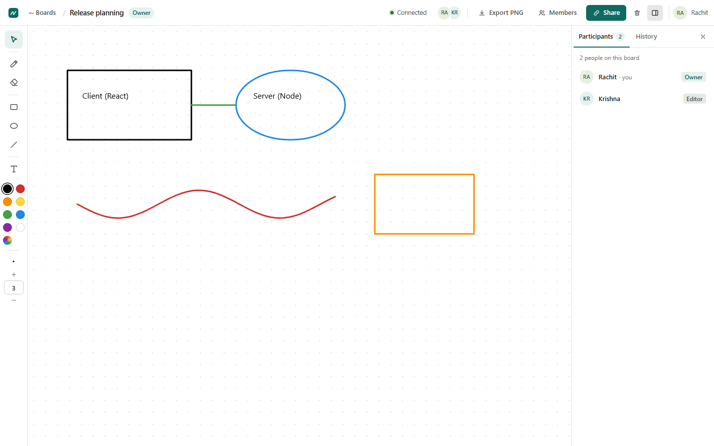
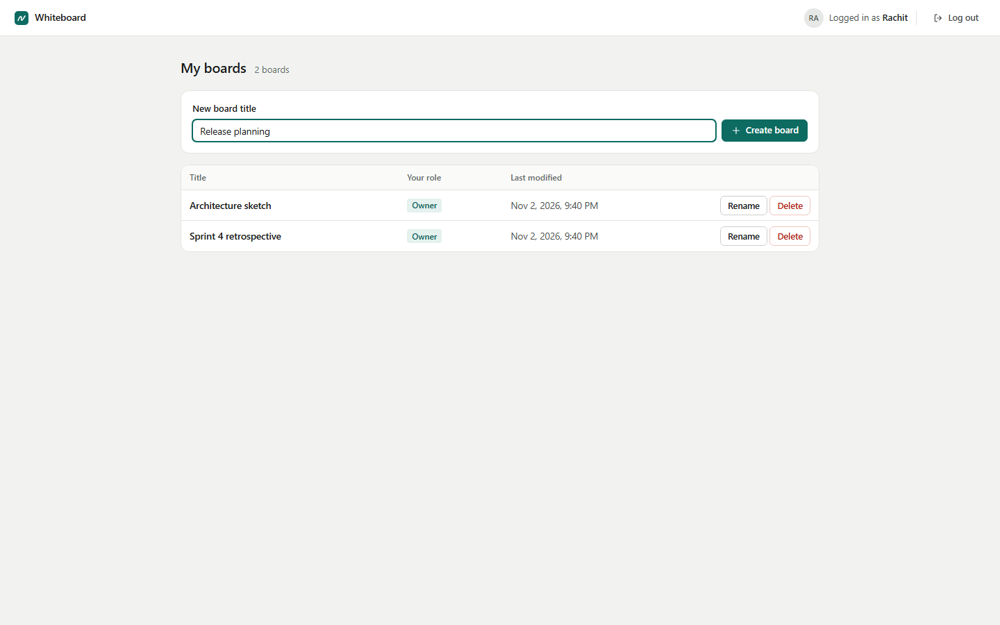
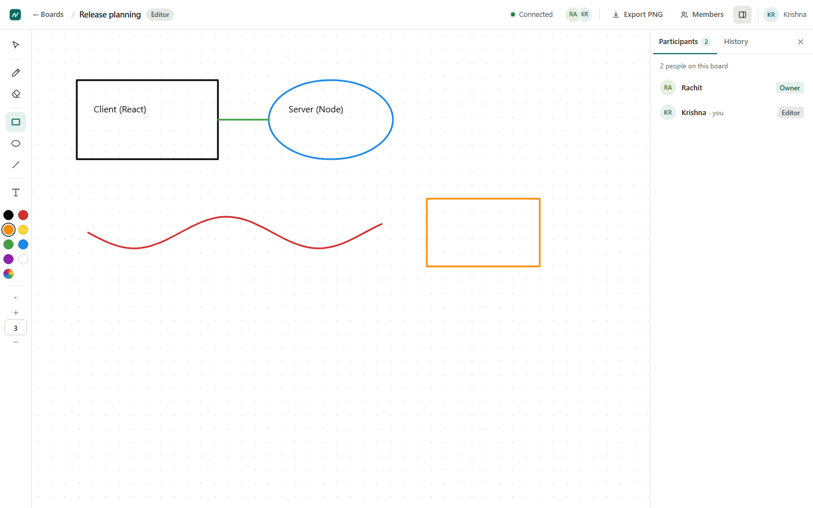
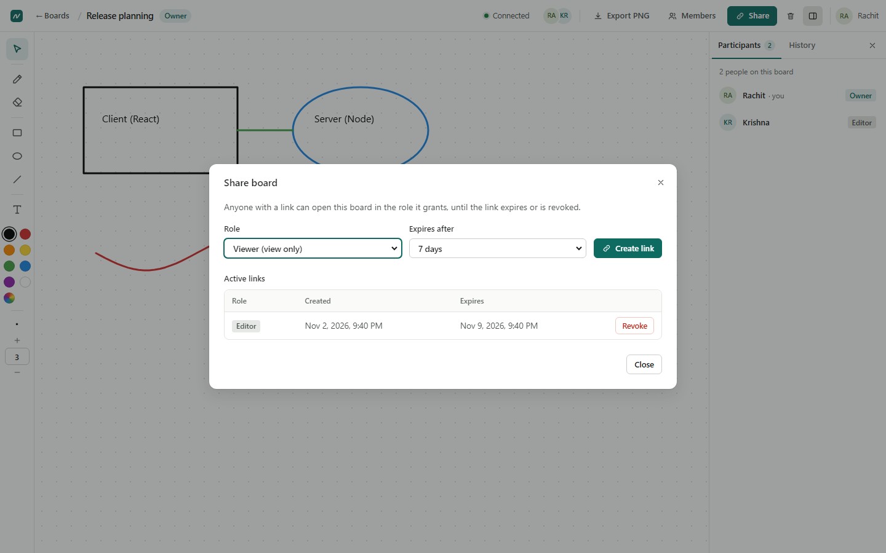
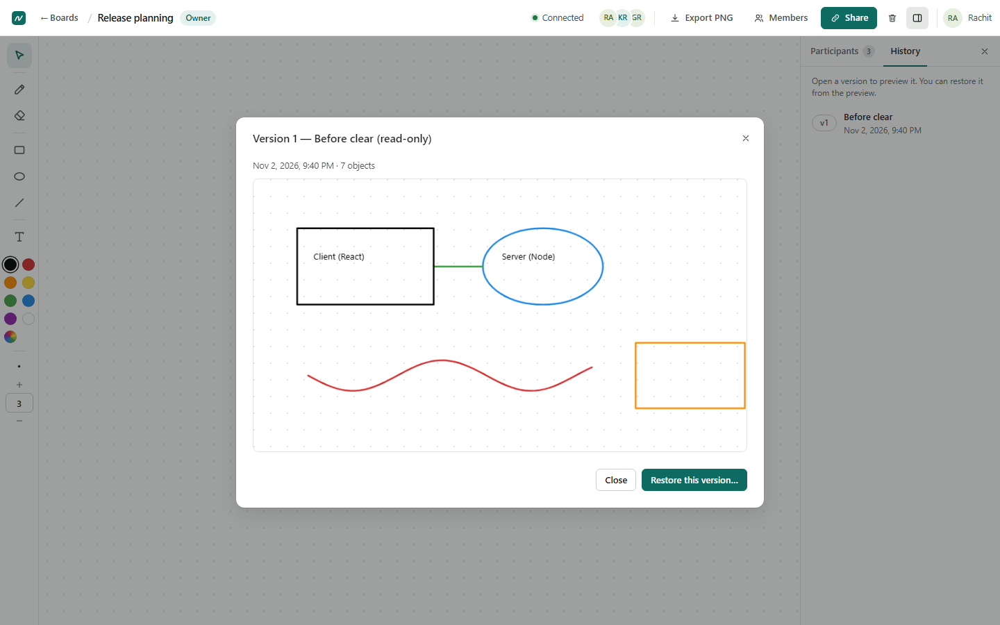
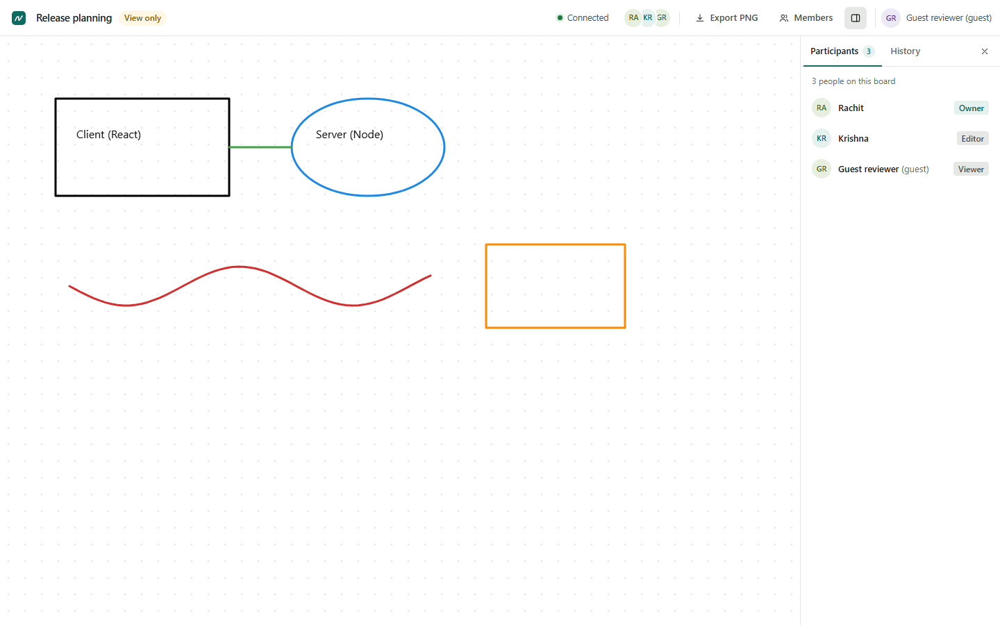
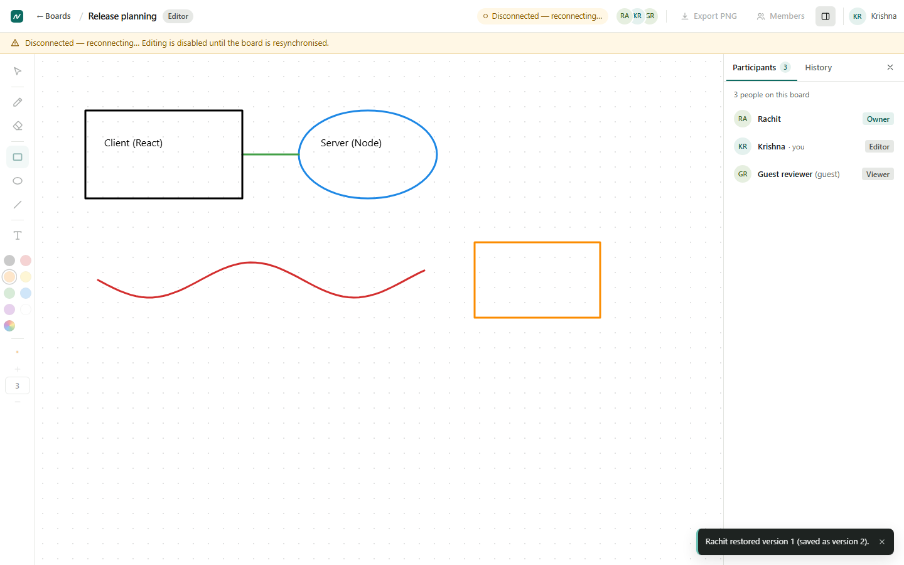
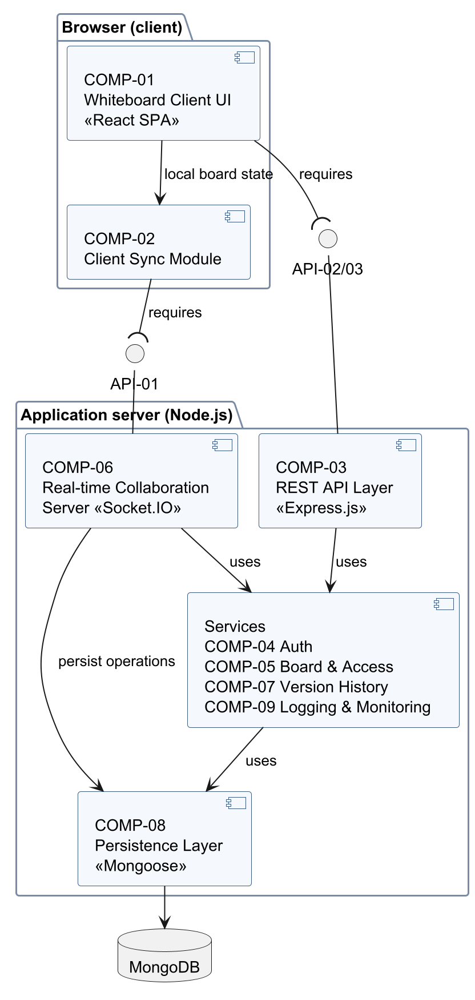

# Real-Time Collaborative Virtual Whiteboard — Team 11

Software Engineering Mini Project, Team 11: Rachit S Mane, P Chinni Krishna Reddy, Pranav V Menon,
Prithvi W.

Several people draw, write and edit the same whiteboard at the same time from their own browsers and
see each other's changes live. Boards keep an automatic version history that the Owner can preview and
restore, and are shared through expiring, revocable Viewer and Editor links.



| Document | Where |
|---|---|
| Requirements, design and test plan (SRS, SAD, STP) | [`docs/`](docs/README.md) — Markdown sources in `docs/working/`, generated Word/PDF in `docs/final/` |
| Verified implementation state, test by test | [`docs/IMPLEMENTATION_STATUS.md`](docs/IMPLEMENTATION_STATUS.md) |
| Latest release readiness report | [`docs/reports/RELEASE_READINESS_2026-11-02.md`](docs/reports/RELEASE_READINESS_2026-11-02.md) |
| Final submission package (presentation, demo guide, audit, checklist) | [`docs/final-submission/`](docs/final-submission/README.md) |

## Contents

- [Problem statement](#problem-statement)
- [Key features](#key-features)
- [Screenshots](#screenshots)
- [Technology stack](#technology-stack)
- [System architecture](#system-architecture)
- [Repository structure](#repository-structure)
- [Prerequisites](#prerequisites)
- [Installation and configuration](#installation-and-configuration)
- [Running the application](#running-the-application)
- [Testing](#testing)
- [Main workflows](#main-workflows)
- [Collaboration and synchronisation](#collaboration-and-synchronisation)
- [Security](#security)
- [Known limitations](#known-limitations)
- [Troubleshooting](#troubleshooting)
- [Team and contributing](#team-and-contributing)

## Problem statement

Team 11's assigned problem: build a web whiteboard on which several users can **draw, write and edit
simultaneously**, with **real-time synchronisation** of every change and a **basic version history**.
Doing this reliably means solving three things at once: a consistent order of concurrent edits, recovery
when a connection drops, and access control so that a shared link never gives more rights than intended.
The requirements are specified in the SRS (`docs/working/srs/`), 50 requirements in total.

## Key features

Implemented and covered by automated tests (requirement IDs from the SRS):

- **Accounts:** registration, login and logout with salted bcrypt password hashes and 24-hour session
  tokens (FR-040, FR-041, SEC-REQ-001, SEC-REQ-002).
- **Boards:** create, list, open and delete boards from a dashboard (FR-042 to FR-044).
- **Drawing tools:** pen, rectangle, ellipse, line, text (up to 500 characters), select/move/restyle/delete,
  an object eraser and Owner-only "clear board"; eight preset colours plus any `#RRGGBB` colour; stroke
  width 1–20 px (FR-001 to FR-007).
- **Real-time collaboration:** every accepted change reaches all participants without reloading, in one
  server-defined order; concurrent edits converge (last write wins per property); a live participant
  list (FR-020 to FR-027, FR-052).
- **Reconnection:** a "Disconnected — reconnecting…" banner, disabled tools while offline, automatic
  reconnection and resynchronisation with the server state (FR-025, NFR-004).
- **Sharing and roles:** Owner, Editor and Viewer roles enforced on the server; share links with a role and
  an expiry of 1 hour, 24 hours or 7 days, revocable at any time; guest access without an account; member
  role changes and removal; ownership transfer (FR-045 to FR-051).
- **Version history:** automatic versions (every 5 minutes while the board changes, before a clear, when
  the last participant leaves), read-only preview, Owner-only restore that never deletes history; at least
  the 20 newest versions are kept (FR-030 to FR-035).
- **Limits and validation:** 15 MiB board size limit, 64 KiB message limit, schema validation of every
  request and message, rate limits (FR-008, SEC-REQ-005, SEC-REQ-006).

Also implemented, but **outside the SRS version 1.0 requirement baseline** (scope decision pending, SRS
§2.7):

- **PNG export:** every participant can download the board as a PNG image (issue #16).
- **Board rename:** the Owner can rename a board from the dashboard; open views update live (issue #13).

## Screenshots

All screenshots were taken from the running application (Chromium, 1440 × 900) for this README; more are
in [`docs/final-submission/screenshots/`](docs/final-submission/screenshots/).

| Dashboard | Editor's view of the same board |
|---|---|
|  |  |
| **Share dialog (Owner)** | **Version preview before restore** |
|  |  |
| **Guest Viewer (read-only)** | **Connection lost** |
|  |  |

## Technology stack

| Layer | Technology (version in `package-lock.json`) |
|---|---|
| Client | React 18.3, Vite 6.4, HTML Canvas 2D, Socket.IO client 4.8 |
| Server | Node.js (22.12+ or 24.9+), Express 5.3, Socket.IO 4.8, Ajv 8 (schema validation), jsonwebtoken 9, bcryptjs 3 |
| Database | MongoDB (verified with 8.2 locally, 8.0 in CI) with Mongoose 8.24 |
| Shared package `@wb/shared` | Client synchronisation module, board object model, error codes — used by the browser, the server and the tests |
| Tests | Jest 30 (unit and integration), Supertest, scripted Socket.IO clients, Playwright 1.50 (E2E) |
| Tooling | ESLint 9, GitHub Actions (`app-ci`, `docs-check`), Python 3 document tools |

The choice of a MERN stack with Socket.IO is decision D10 in [`docs/DECISIONS.md`](docs/DECISIONS.md).

## System architecture



The SAD (`docs/working/sad/`) describes nine components:

| Component | Code | Responsibility |
|---|---|---|
| COMP-01 Whiteboard Client UI | `client/src/` | React SPA: dashboard, board canvas, toolbar, side panel, dialogs |
| COMP-02 Client Sync Module | `shared/src/syncClient.js` | Confirmed state, optimistic pending operations, ordering by sequence number, resynchronisation |
| COMP-03 REST API Layer | `server/src/rest/app.js` | Express routes under `/api/v1`, security headers, request IDs, error format |
| COMP-04 Auth Service | `server/src/auth/` | Registration, bcrypt, JWT session and guest tokens, logout revocation, login limiter |
| COMP-05 Board & Access Service | `server/src/access/` | Boards, members, share links, ownership transfer; the single permission policy |
| COMP-06 Real-time Collaboration Server | `server/src/realtime/` | Socket.IO `/board` namespace, one room and one FIFO queue per board, validation, size limit |
| COMP-07 Version History Service | `server/src/versions/` | Automatic versions, preview, idempotent restore |
| COMP-08 Persistence Layer | `server/src/db/` | Mongoose models, MongoDB validator, start-up integrity check |
| COMP-09 Logging & Monitoring | `server/src/logger.js` | JSON logs, security events, health check |

Two interfaces connect client and server: a **REST API** (`/api/v1`, SAD API-02 and API-03) for accounts,
boards, links, members and versions, and a **Socket.IO** connection (namespace `/board`, SAD API-01) for
board operations, presence and notifications. Both use the same tokens and the same permission policy.

## Repository structure

```
client/      COMP-01: React single-page application (Vite); unit tests in client/tests/
server/      COMP-03..09: Express REST API, Socket.IO server, services, persistence, logging;
             unit and integration tests in server/tests/
shared/      COMP-02 sync module, board object model, shared error codes; tests in shared/tests/
e2e/         Playwright end-to-end tests (31 tests in 7 spec files)
scripts/     development launcher, local MongoDB helper, performance harness, TLS verifier
tools/       Python document tools: traceability check, Word/PDF build, diagram rendering, size model
docs/        SRS, SAD, STP sources, decisions, traceability, reports, evidence, final submission package
.github/     CI workflows: app-ci.yml (application) and docs-check.yml (traceability)
```

## Prerequisites

- **Node.js 22.12+ (22 LTS) or 24.9+** (`package.json` `engines`). Node.js before 22.12 cannot load the
  E2E set-up, and Jest fails on Node.js 24.0–24.8 with `module is already linked`.
- **MongoDB** (verified with 8.2): `mongod` on the `PATH`, or `MONGOD_BIN` set to its full path, or a
  MongoDB service already listening on port 27017.
- **Playwright browsers** for E2E tests: `npx playwright install chromium` (add `firefox webkit` for the
  cross-browser run; Chrome and Edge are used from their normal installations).
- Optional, for the document tools: Python 3.10+, Java 11+ (diagrams), Microsoft Word (PDF export).

## Installation and configuration

```sh
git clone https://github.com/RachitSMane/SE-Mini-Project-Team-11.git
cd SE-Mini-Project-Team-11
npm install
cp server/.env.example server/.env
```

Edit `server/.env` and replace the two secret placeholders with random values of at least 32 characters
(the server refuses to start otherwise). Generate each with:

```sh
node -e "console.log(require('crypto').randomBytes(48).toString('base64url'))"
```

`server/.env` is ignored by Git — never commit it, and never put real secrets into documentation.

| Variable | Default | Meaning |
|---|---|---|
| `PORT`, `HOST` | `4000`, `127.0.0.1` | API listen address |
| `MONGO_URL` | `mongodb://127.0.0.1:27017/whiteboard` | database connection |
| `JWT_SECRET`, `LOGIN_HMAC_KEY` | — (required, ≥ 32 characters) | token signing key; key for the failed-login limiter |
| `PUBLIC_URL` | `http://localhost:5173` | base URL of share links (the client origin) |
| `CLIENT_ORIGIN` | empty | only when the client is served from a different origin than the API |
| `CLIENT_DIST` | empty | serve the built client from the API server (path to `client/dist`) |
| `VERSION_INTERVAL_MS` | `300000` | periodic version interval (5 minutes, D11a) |
| `BCRYPT_COST` | `12` | password hashing cost (minimum 12 in production) |
| `LOG_LEVEL`, `LOG_FILE` | `debug` in development, `info` otherwise; no file (`.env.example` sets `logs/server.log`) | JSON log output |
| `TRUST_PROXY`, `FORCE_HTTPS` | `false`, `false` | deployment behind a TLS-terminating proxy (see [Security](#security)) |

## Running the application

### Development (two terminals)

```sh
npm run db:start   # local mongod on port 27017 (MONGO_PORT to change), data in ./.data/db;
                   # skip it if a MongoDB service already listens on 27017
npm run dev        # API on http://127.0.0.1:4000 (node --watch) and the client on http://localhost:5173
```

`npm run dev` (`scripts/dev.js`) starts the API server and the Vite dev server together; Vite forwards
`/api` and `/socket.io` to the API. Open http://localhost:5173, register, create a board, and use
**Share** to invite others (open the link in another browser or a private window to join as a guest).

### Single server (production-like)

```sh
npm run build      # production client build in client/dist (no test hooks)
# in server/.env: CLIENT_DIST=../client/dist  (relative to the server folder, or absolute)
npm start          # API, Socket.IO and the built client on PORT (default 4000)
```

`npm run test:e2e` and `npm run perf` leave the **test build** in `client/dist`; run `npm run build`
again before serving the client.

## Testing

| Command | What it runs |
|---|---|
| `npm run lint` | ESLint over the whole repository |
| `npm run test:unit` | Jest unit tests: permission matrix, validation, services, sync module, error codes, canvas geometry, PNG export layout (9 suites, 110 tests) |
| `npm run test:integration` | REST + Socket.IO tests against a throw-away `mongod`: auth, access, boards, sync, five-client synchronisation, versions, recovery with fault injection, database integrity, transport and TLS (13 suites, 100 tests) |
| `npm test` | unit and integration together |
| `npm run test:e2e` | builds the client test build, then Playwright in Chromium against the real server (31 tests) |
| `npm run test:e2e:browsers` | the same E2E suite in **installed Google Chrome**, **installed Microsoft Edge**, **Playwright's Firefox** and **Playwright's WebKit**; choose with `E2E_BROWSERS=chrome,msedge,firefox,webkit` |
| `npm run perf` | performance harness: TC-019 latency, TC-013 restore, TC-020 load, TC-009 reconnection (about 10 minutes; `PERF_QUICK=1` for a smoke run) |

The counts are those of the final validation on 02-11-2026; the logs are in
`docs/evidence/2026-11-02-final-validation/`.

**Browser coverage, precisely.** Playwright's Firefox is a patched build, not the stable Mozilla Firefox
release; Playwright's WebKit is the engine of Safari, not Apple Safari. Stable Mozilla Firefox was checked
manually (TC-021, Firefox 158) and with Playwright's experimental BiDi driver (Firefox 159: 22 of 31 E2E
tests pass; the other 7 fail on driver limitations, not application defects). **Apple Safari has not been
tested.** Details: release readiness report, §4.

The integration and E2E set-ups start their own `mongod` on a free port (set `TEST_MONGO_URL`, e.g.
`mongodb://127.0.0.1:27017`, to use an existing MongoDB). Test-only hooks (`window.__wbTest`,
`FAULT_INJECT`, `LINK_EXPIRY_OVERRIDE_SEC`, short `VERSION_INTERVAL_MS`) are active only with
`NODE_ENV=test` or in the client test build (`npm run build:test`).

Documentation checks (Python 3): `python tools/check_trace.py` (traceability, must end with
`0 failed`) and `python -m unittest discover -s tools/tests`.

GitHub Actions runs `app-ci` (lint, unit, integration, production build, Chromium E2E) and `docs-check`
(traceability) on every Pull Request and push to `main`.

## Main workflows

1. **Register and log in** (`/register`, `/login`) → the dashboard (`/`) lists your boards with role and
   last change; create a board with a title of 1–100 characters.
2. **Draw** on the board (`/boards/<id>`): choose a tool on the left (keyboard: V select, P pen, E eraser,
   R rectangle, O ellipse, L line, T text), a colour and a width; double-click a text object with the
   select tool to edit it.
3. **Share:** the Owner opens **Share**, chooses Viewer or Editor and an expiry, and copies the link (shown
   once). A logged-in user who opens it becomes a member; anyone else can join as a guest with a display
   name. **Members** lists who has access; the Owner changes roles, removes members or transfers ownership.
4. **History:** the side panel's **History** tab lists versions; open one to preview it read-only; the
   Owner can restore it, which saves a new version and updates every participant.
5. **Export PNG** downloads the board as an image (outside the SRS baseline, see above).

A step-by-step demonstration script with technical explanations is in
[`docs/final-submission/DEMO_GUIDE.md`](docs/final-submission/DEMO_GUIDE.md).

## Collaboration and synchronisation

The browser and the server talk over one Socket.IO connection to the namespace `/board` (WebSocket
transport only). The full protocol is API-01 in the SAD (`docs/working/sad/04c1-api01-realtime.md`).

| Direction | Event | Purpose |
|---|---|---|
| client → server | `board:join` `{boardId}` | authorise, join the board's room, receive `{role, state: {seq, objects}, participants}` |
| client → server | `op:submit` `{boardId, clientOpId, type, payload}` | `object:add`, `object:update`, `object:delete`, `board:clear`; acknowledged with `{ok, seq}` or an error code |
| server → others | `op:applied` | every accepted operation with its sequence number |
| server → room | `presence:update`, `board:state` (after a restore), `role:changed`, `access:revoked`, `version:created`, `version:restored`, `board:renamed` | presence, access, version and title changes without reloading |

**Server (authoritative state).** `realtimeServer.js` authenticates every connection (JWT in the
handshake), limits each connection to 30 operations per second and keeps one room per board.
`boardEngine.js` runs each operation in the board's FIFO queue (`boardQueue.js`): authorise →
schema-validate → size limit → persist to MongoDB → assign the next sequence number → acknowledge the
sender and broadcast `op:applied`. Concurrent edits of the same property resolve to the higher sequence
number.

**Client (`shared/src/syncClient.js`).** Keeps the confirmed server state, the user's own
unacknowledged operations (shown optimistically, rolled back if rejected) and a buffer for out-of-order
events. Events are applied strictly in sequence order; duplicates are ignored; a gap not closed within
1 s, or more than 100 buffered events, triggers a resynchronising `board:join`. Malformed events are never
applied. On every reconnection the client joins again and replaces its state; unconfirmed changes are
discarded with a notice. An operation without acknowledgement for 10 s forces a reconnect, and a
connection closed by the server is retried once.

## Security

- Passwords: 8–72 characters, salted bcrypt hashes (cost 12), never logged (SEC-REQ-001).
- Tokens: JWT session tokens (24 h, revoked at logout) and board-bound guest tokens (expire with the link,
  at most 24 h); session tokens in `localStorage`, guest tokens in `sessionStorage` (SEC-REQ-002).
- Authorisation: one server-side policy for REST and Socket.IO; roles are always read from the database,
  never from the request; no role → 404, too low a role → 403 (SEC-REQ-003).
- Share-link tokens: 256 random bits, stored only as SHA-256 hashes, rejected after expiry or revocation
  (SEC-REQ-004).
- Input: JSON-schema validation of every request and message, 64 KiB message limit, text rendered as
  plain text (SEC-REQ-005); failed logins limited to 5 per address per 15 minutes, operations to 30 per
  second per connection (SEC-REQ-006); security events logged without secrets (SEC-REQ-008).
- Headers: `X-Content-Type-Options`, `X-Frame-Options: DENY`, `Referrer-Policy`, and a Content Security
  Policy when the server serves the client.
- **HTTPS (SEC-REQ-007).** In any deployed environment run the server behind one TLS-terminating reverse
  proxy and set `NODE_ENV=production`, `TRUST_PROXY=true`, `FORCE_HTTPS=true` and
  `PUBLIC_URL=https://<your-host>` in `server/.env` (plus `CLIENT_DIST` after `npm run build`). The server
  refuses to start with `FORCE_HTTPS` but without `TRUST_PROXY` or an `https://` `PUBLIC_URL`. The proxy
  must forward WebSocket upgrades for `/socket.io/`. On the deployed host, verify TC-109 with
  `node scripts/verify-tls.js https://<your-host>` (`docs/reviews/TC109_DEPLOYMENT_PLAN.md`).

## Known limitations

- **TC-109 / SEC-REQ-007 is Blocked:** there is no deployed HTTPS instance, so 49 of 50 requirements are
  verified. The application-side HTTPS controls are tested locally.
- **Apple Safari** has not been tested; stable Mozilla Firefox only partly by automation (see
  [Testing](#testing)).
- **Single server instance:** horizontal scaling is out of scope; a board's content is limited to 15 MiB.
- **Unconfirmed changes are discarded** after a reconnection (the user is told); there is no automatic
  resubmission.
- **Physical-device checks pending:** real 125 % display scaling, touch screens and the Windows
  high-contrast theme were tested with browser emulation only.
- **Owner notice not shown:** the server's `notice` event (a version that could not be saved) is not
  displayed by the client (SAD §4.6).
- **Scope decision pending:** PNG export and board rename are implemented but outside the SRS version 1.0
  baseline (SRS §2.7, DECISIONS.md E6).
- Team sign-off of the SRS, SAD and STP approval tables is pending (DECISIONS.md E1).

## Troubleshooting

- **`@wb/shared` cannot be resolved (`ERR_MODULE_NOT_FOUND`), or the folders in `node_modules/@wb/` are
  empty:** the workspace links are broken (typically after copying or unzipping the project folder). Run
  `npm install` again in the repository root.
- **Every Jest suite fails with `module is already linked`:** the installed Node.js is 24.0–24.8. Install
  Node.js 22 LTS or 24.9 or later.
- **Integration tests cannot start `mongod`:** set `MONGOD_BIN`, or `TEST_MONGO_URL` to use a running
  MongoDB:

  ```sh
  # Git Bash
  MONGOD_BIN="C:/Program Files/MongoDB/Server/8.2/bin/mongod.exe" npm test
  # PowerShell
  $env:MONGOD_BIN = 'C:\Program Files\MongoDB\Server\8.2\bin\mongod.exe'; npm test
  ```

- **`npm run dev` stops with "server/.env is missing":** copy `server/.env.example` to `server/.env` and
  set the two secrets.

## Team and contributing

| Member | Main responsibilities |
|---|---|
| Rachit S Mane | SRS lead, repository owner, document assembly; frontend and canvas, authentication, API integration, frontend validation, responsive layout (#8, #14, #17, #21, #23) |
| P Chinni Krishna Reddy | SAD lead, real-time synchronisation and connection lifecycle (#7, #11, #18, #22, #24) |
| Pranav V Menon | STP lead, board management, export, backend and E2E tests, release readiness (#10, #13, #16, #19, #26) |
| Prithvi W | Security and traceability lead, shared errors, access control, database integrity, cross-browser testing (#9, #12, #15, #20, #25) |

The issue assignments are those of the GitHub issues and milestones (four sprints, all closed).

**Contributing.** Branch from an up-to-date `main` (`git switch main && git pull`, then
`git switch -c <type>/<topic>`), keep each commit to one concern, and open a Pull Request into `main`.
Before pushing, run `npm run lint`, `npm test` and — for UI changes — `npm run test:e2e`; for document
changes run `python tools/check_trace.py`. CI must pass and a teammate should review before merging. Do
not edit the generated `.docx` files by hand; follow the document workflow in [`docs/README.md`](docs/README.md).
