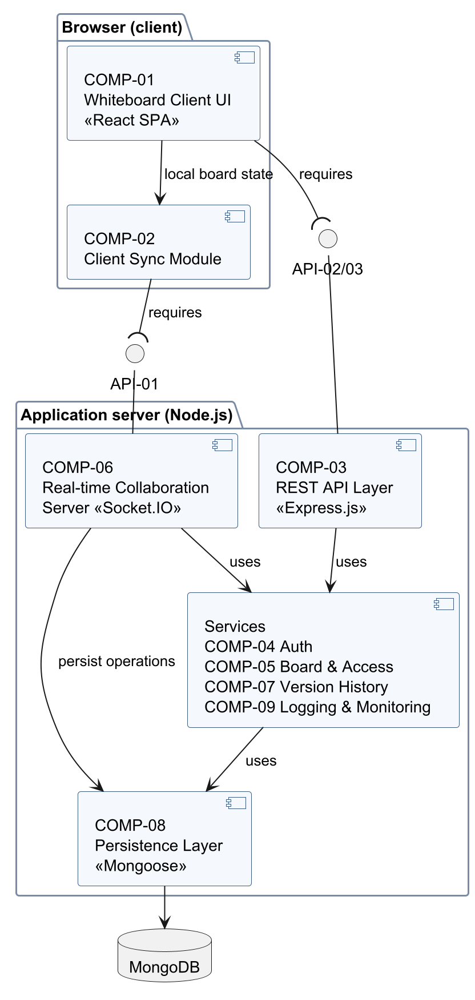
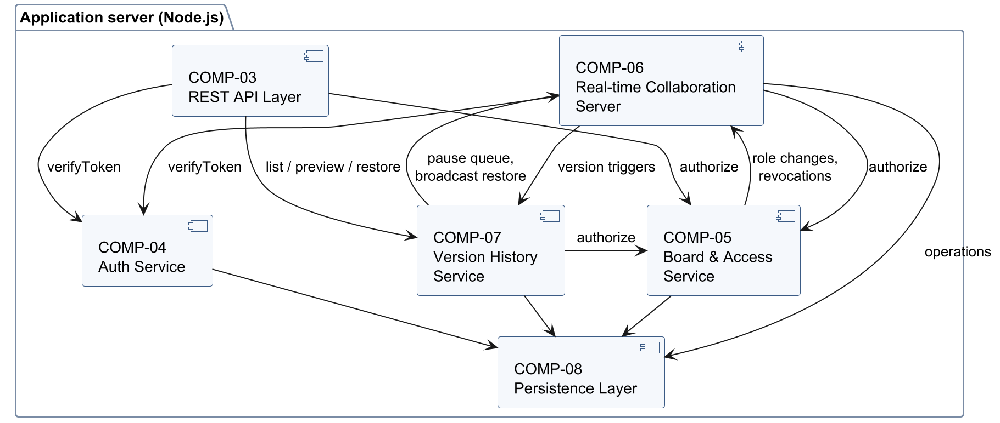

<!-- Owner: Krishna | Reviewers: Prithvi, Rachit | Status: v1.0 -->

### 3.3 Component (UML) Diagram

The template placeholder mentions a class diagram; the assignment brief requires a **UML component
diagram**, which is provided here in two parts so that its labels stay legible:

- **Figure 1 (overview)** shows the client and server packages, the two external interfaces —
  API-01 (Socket.IO events) and API-02/API-03 (REST over HTTPS) — as provided (lollipop) and
  required (socket) interfaces, and the server layers. The four service components are grouped in
  one box; their individual dependencies are shown in Figure 2.
- **Figure 2 (server dependencies)** shows the labelled dependencies between the server components,
  including Version History → Board & Access (`authorize`, SD-02) and Board & Access → Real-time
  Collaboration Server (role changes and revocations, SD-03, SD-04). Every server component also
  writes logs and metrics to COMP-09 (§4.4); these arrows are omitted for readability.

### 3.4 Component Descriptions

| ID | Component | Responsibilities | Provided interfaces | Realises |
|---|---|---|---|---|
| COMP-01 | Whiteboard Client UI | React single-page application: dashboard, board canvas rendering, toolbar, participant panel, version panel, sharing and members dialogs (including ownership transfer with confirmation); role-aware enabling of controls; error, board-full and connection-status messages; `board-ready` performance mark. | Browser UI | FR-001–FR-007, FR-031, FR-032, FR-043, FR-052, NFR-003, NFR-006, NFR-007 |
| COMP-02 | Client Sync Module | Keeps `confirmed` state, `pending` own operations and an out-of-order `buffer` (§4.1.3); renders optimistically; applies acknowledgements and `op:applied` strictly by sequence number; repairs gaps with `board:join`; rolls back rejected operations; reconnects with bounded backoff and resynchronises (§4.1.4). | Board state store used by COMP-01 | FR-020–FR-026, NFR-001, NFR-004 |
| COMP-03 | REST API Layer | Express.js routes for API-02 and API-03; middleware chain for token verification, schema validation, rate limiting, error formatting and request IDs. | API-02, API-03 (HTTPS, JSON) | FR-040–FR-050, SEC-REQ-002, SEC-REQ-005, SEC-REQ-006 |
| COMP-04 | Auth Service | Registration, password hashing and verification, issuing and verifying session tokens, logout revocation list, guest tokens derived from share links. | `verifyToken`, `issueSession`, `issueGuestToken` (internal) | FR-040, FR-041, FR-046, SEC-REQ-001, SEC-REQ-002 |
| COMP-05 | Board & Access Service | Boards, members and share links; the permission policy (single implementation of the FR-051 matrix) used by every other server component; link creation, expiry and revocation; ownership transfer (API-02, SD-04); board deletion. | `authorize(actor, boardId, action)`, board/link/member operations (internal) | FR-042–FR-051, SEC-REQ-003, SEC-REQ-004 |
| COMP-06 | Real-time Collaboration Server | Socket.IO server: connection authentication, one room per board, per-board task queue that serialises operations, clear, restore and version tasks, validation and authorisation of every event, board size limit, sequence-number assignment, persistence before acknowledgement and broadcast (§4.1.2), presence, role-change notifications and forced disconnects on revocation, removal, deletion and ownership transfer. | API-01 (Socket.IO events) | FR-001–FR-008, FR-020–FR-027, FR-047–FR-050, FR-052, NFR-001, NFR-002, SEC-REQ-003, SEC-REQ-005, SEC-REQ-006 |
| COMP-07 | Version History Service | Automatic version triggers (interval *T*, before clear, last participant leaves) with the no-change rule; version list and preview; owner-only, journalled and idempotent restore that always creates a new version; retention of the 20 newest; defensive snapshot size check; hand-off of restored state to COMP-06 for broadcast. | API-03 operations, `snapshot(boardId, trigger)` (internal) | FR-007, FR-030–FR-035, NFR-005 |
| COMP-08 | Persistence Layer | MongoDB database and Mongoose models/repositories for users, boards, board objects, memberships, share links, versions and revoked tokens; indexes and atomic updates. | Repository functions (internal) | FR-007, FR-027, FR-033 (journal and start-up recovery), FR-035, FR-044, SEC-REQ-001, SEC-REQ-004 |
| COMP-09 | Logging & Monitoring | Structured JSON logging with request and correlation IDs, security event log, metrics (operation latency, connections, rejections, restores), health-check endpoint. | `log`, `metric` (internal); `GET /api/v1/health` | SEC-REQ-008, NFR-001, NFR-004 (measurement support) |
