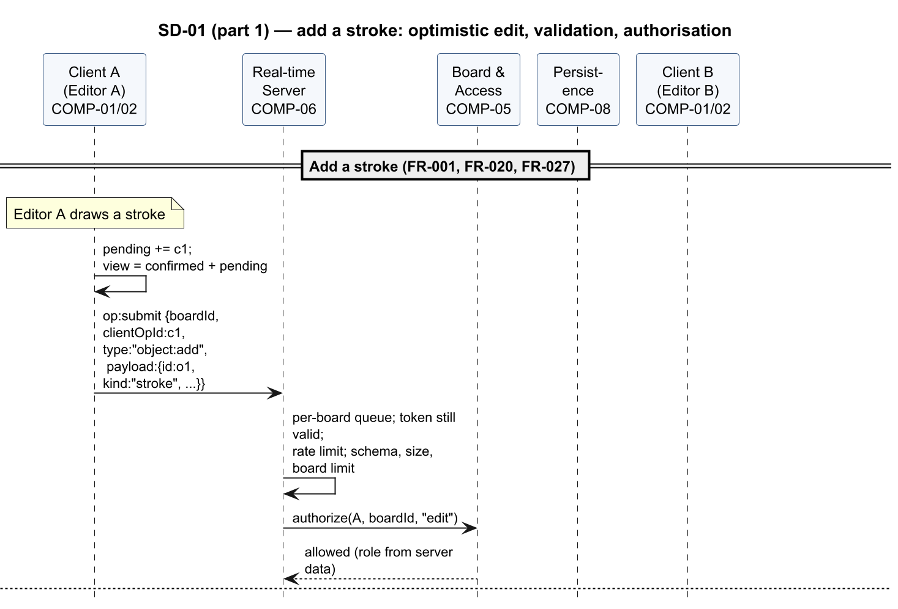
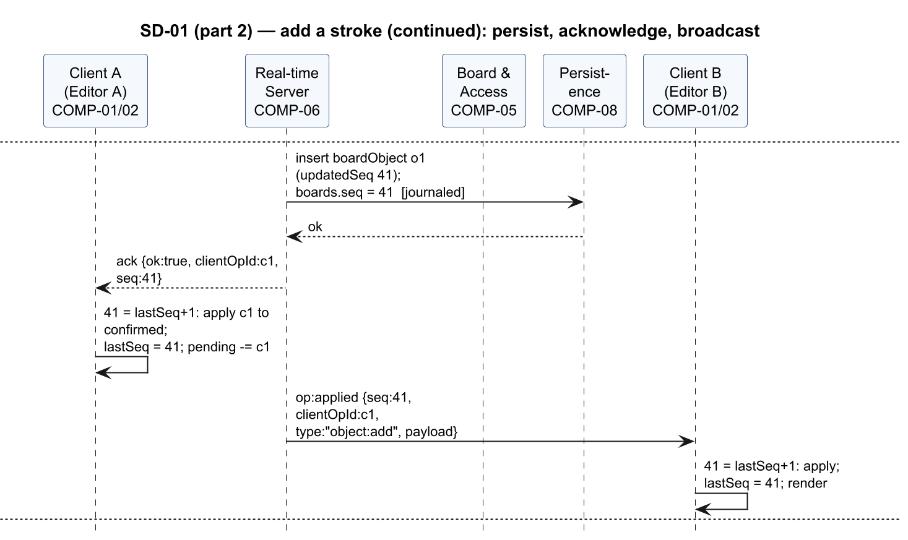
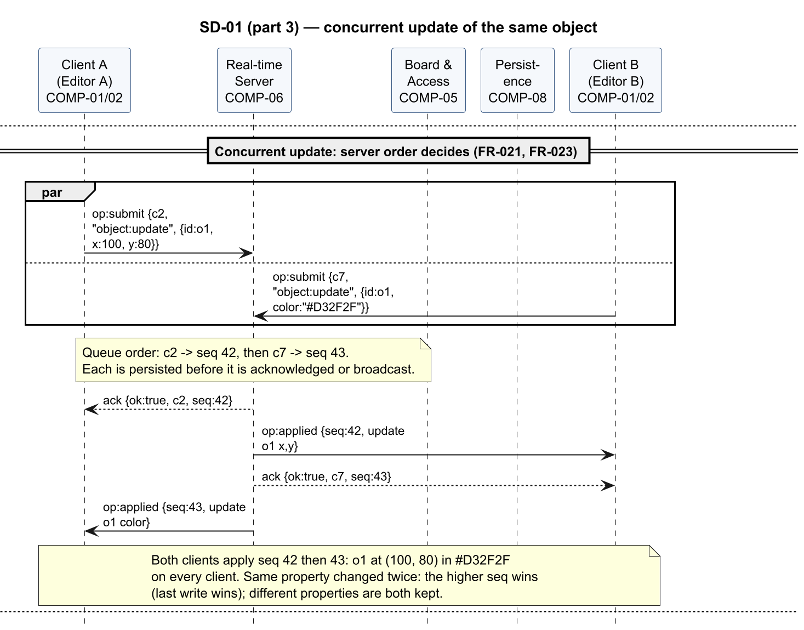
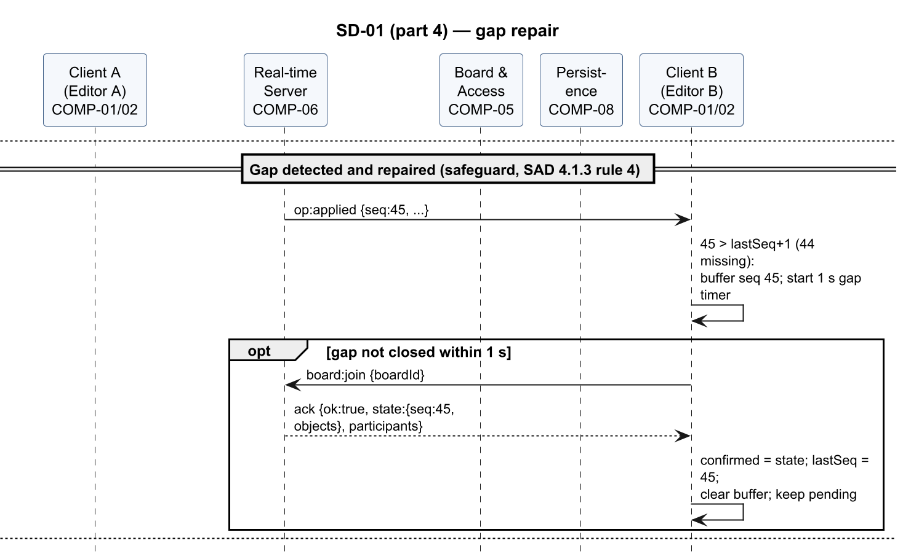
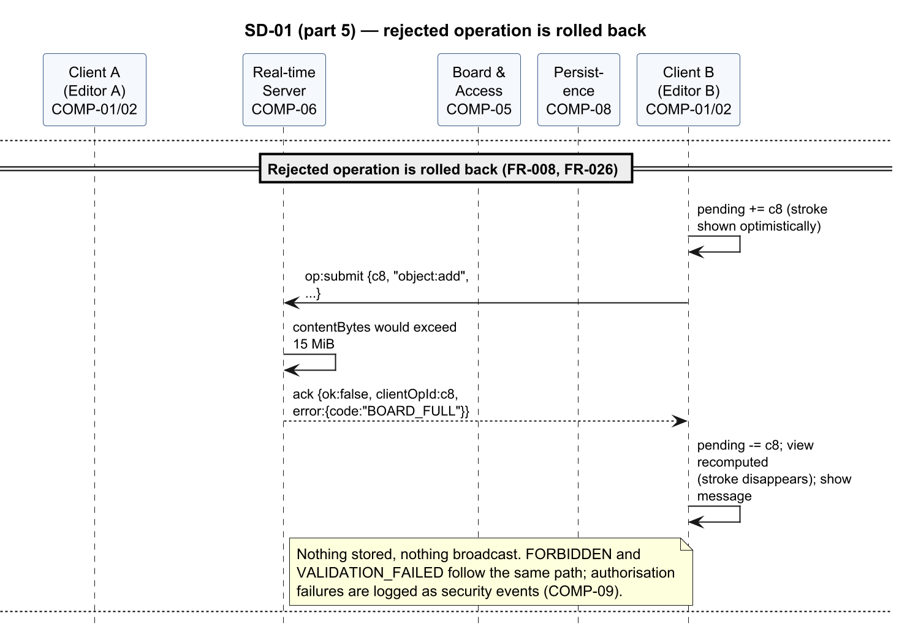
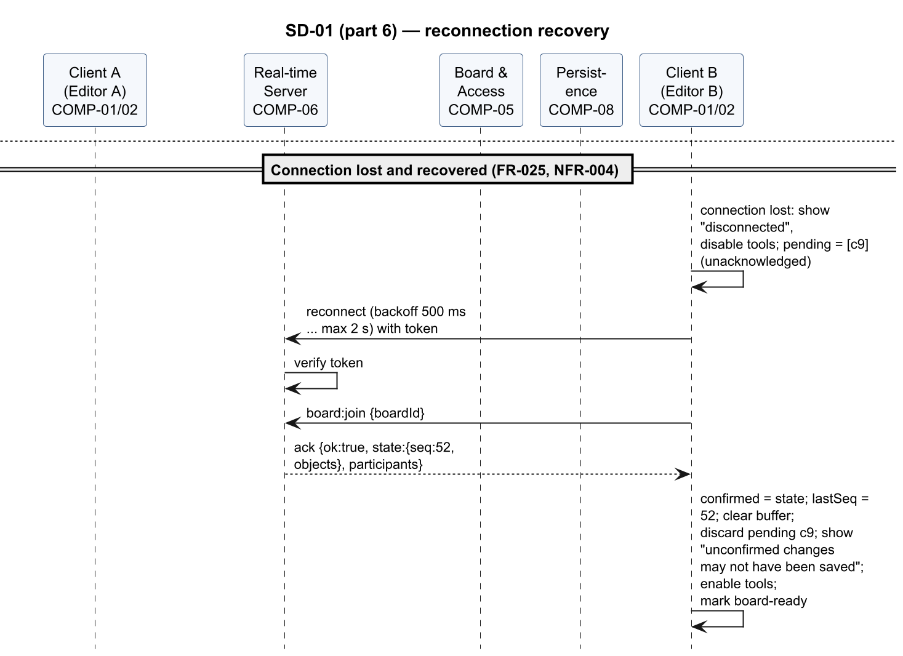

<!-- Owner: Krishna | Reviewers: Rachit, Pranav | Status: v1.0 -->

#### SD-01 — Live drawing synchronisation, acknowledgement and reconciliation

Realises FR-001, FR-008, FR-020 to FR-023, FR-026, FR-027, FR-051, NFR-001. Editor A adds a
stroke: the client shows it optimistically, the server persists it, acknowledges it with its
sequence number and broadcasts it. Then A and Editor B update the same object at nearly the same
time and the server's queue order decides the final state. The diagram also shows the gap-repair
safeguard, the rollback of a rejected operation and reconnection recovery (protocol rules in §4.1.3–§4.1.4).

Figures 3–8 show the flow in 6 parts.

