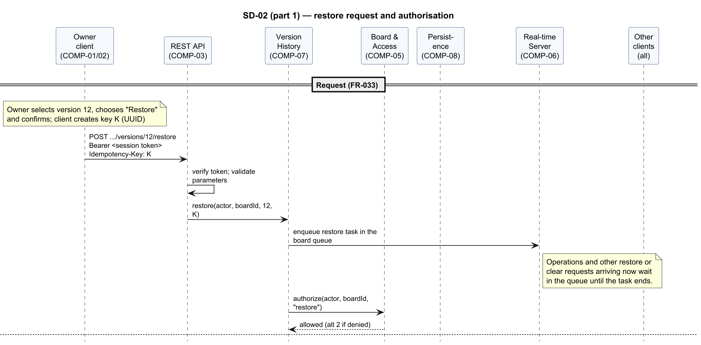
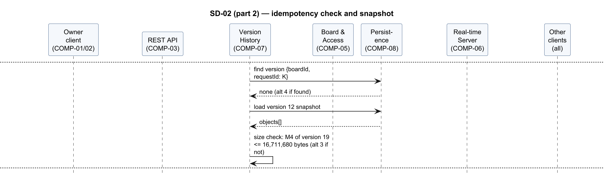
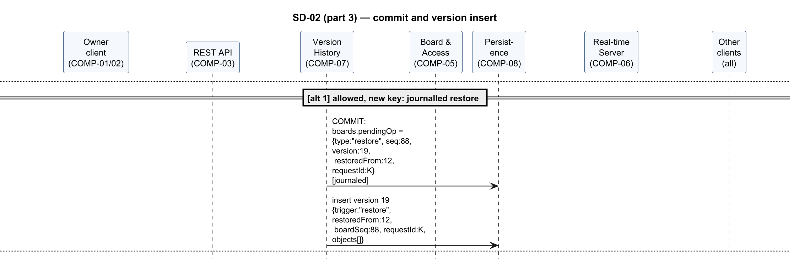
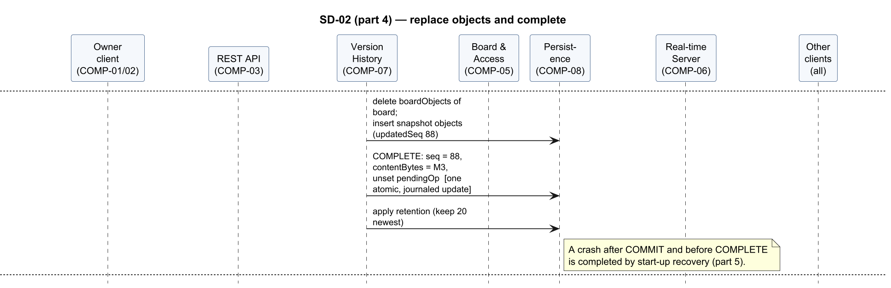
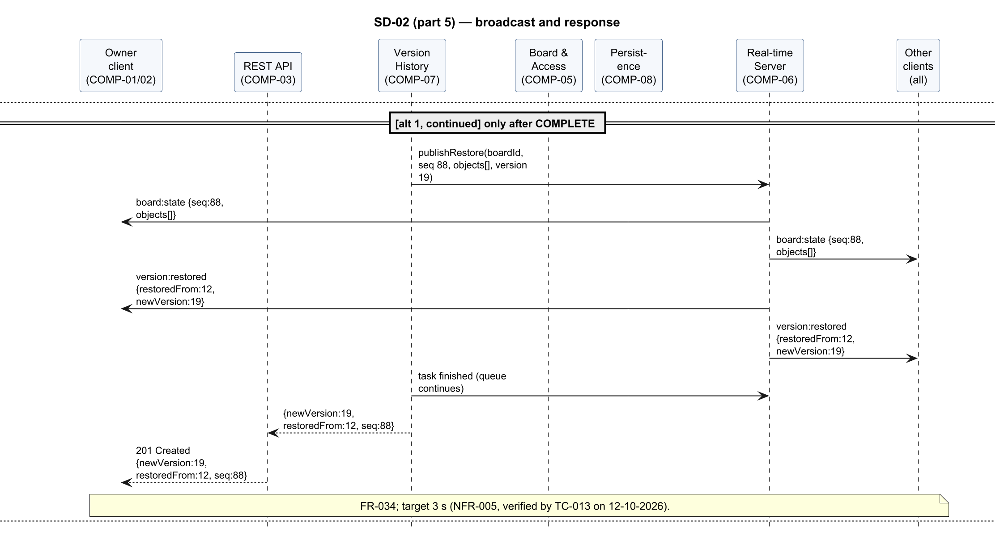
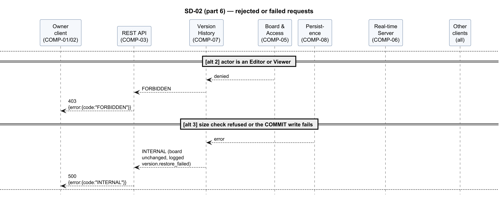
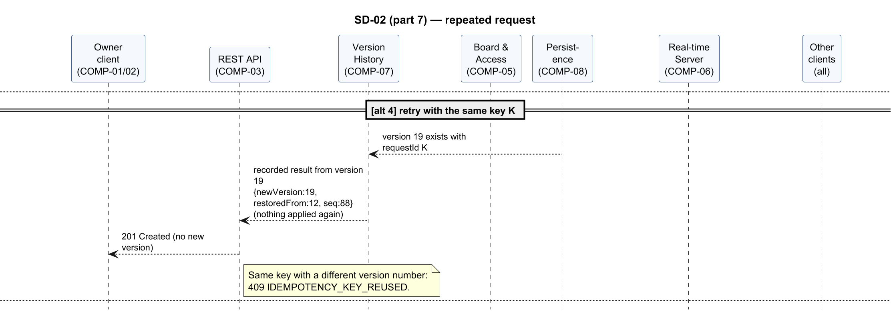
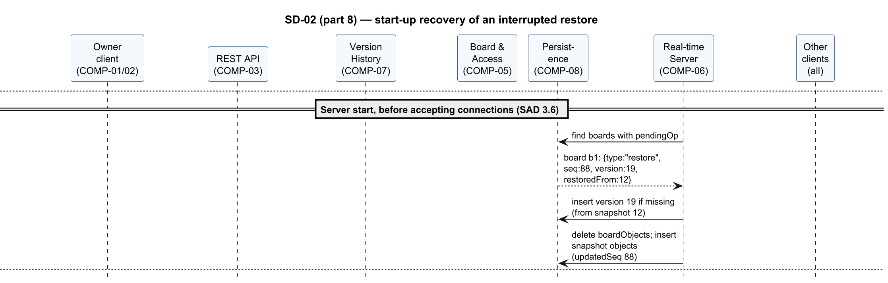
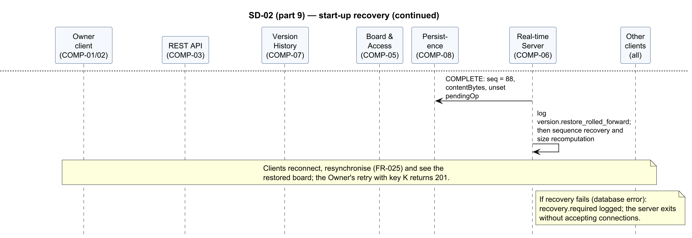

<!-- Owner: Rachit | Reviewers: Krishna | Status: v1.0 -->

#### SD-02 — Restore a previous version

Realises FR-033, FR-034, FR-051, NFR-005. The Owner restores version *n* through API-03. The
restore runs as a task in the board queue: it checks the Owner role and the idempotency key,
commits the operation in the durable journal (`boards.pendingOp`), stores the restore version,
replaces the board objects, completes the journal entry and only then pushes the restored state to
every participant (§3.6). A restore from a non-Owner, or one that fails before its commit, is
rejected without any change; a restore interrupted after its commit is completed at start-up.

Figures 9–17 show the flow in 9 parts.

