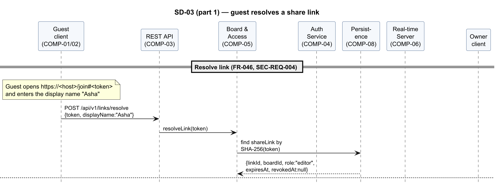
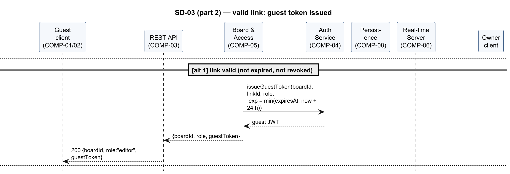
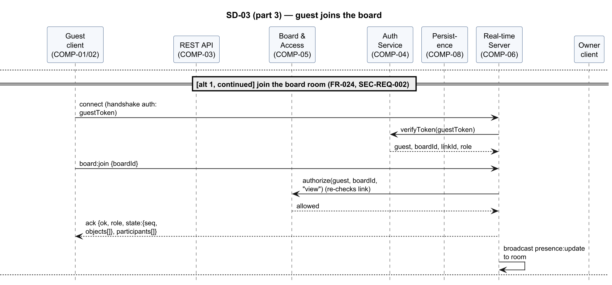
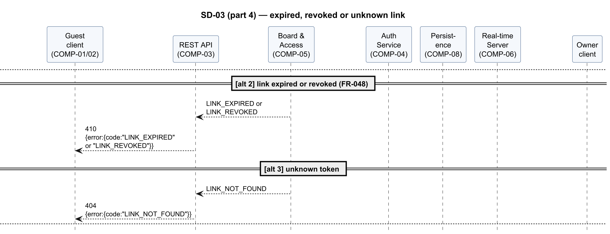
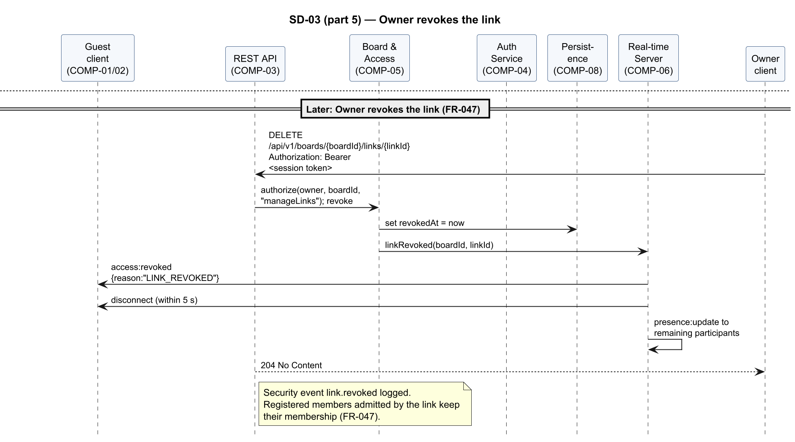

<!-- Owner: Prithvi | Reviewers: Krishna | Status: v1.0 -->

#### SD-03 — Join through a share link, then revocation

Realises FR-024, FR-046, FR-047, FR-048, FR-051, SEC-REQ-002, SEC-REQ-004. A guest opens a share
link, the server validates the hashed token and issues a board-scoped guest token, and the guest
joins the board room and receives the full state. When the Owner later revokes the link, the
guest's socket is notified and disconnected.

Figures 18–22 show the flow in 5 parts.

