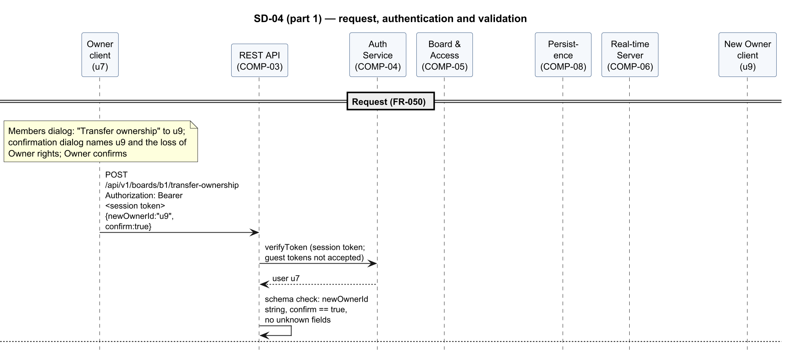
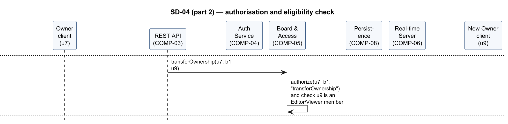
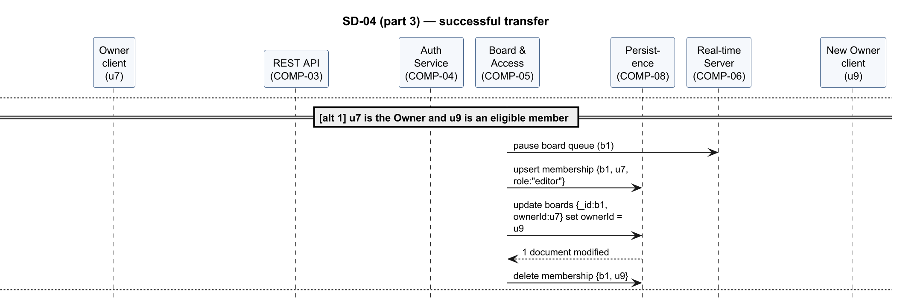
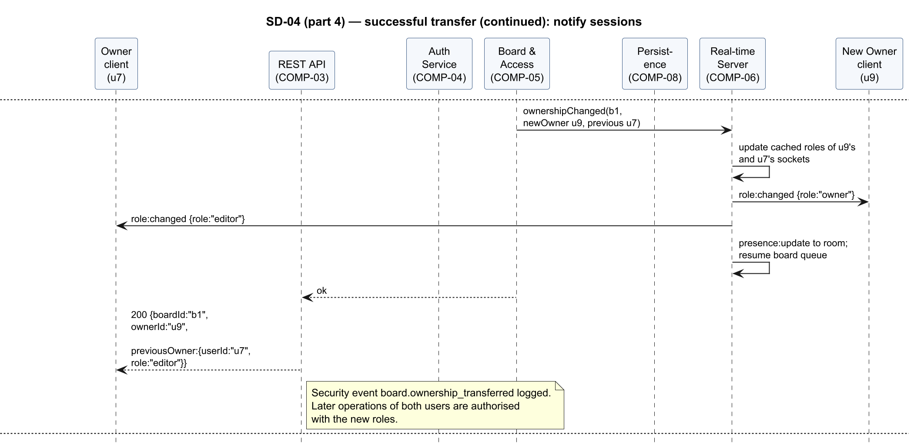
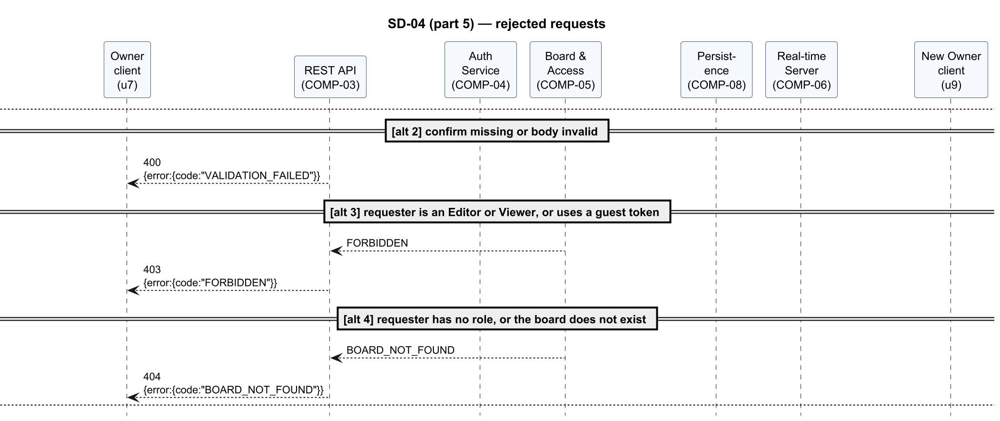
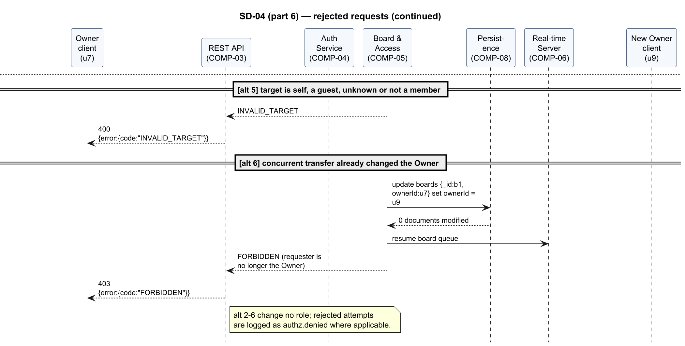

<!-- Owner: Prithvi | Reviewers: Krishna, Rachit | Status: v1.0 -->

#### SD-04 — Transfer board ownership

Realises FR-050, FR-051, SEC-REQ-003, SEC-REQ-008. The Owner transfers ownership to an Editor or
Viewer member through API-02 (`POST /api/v1/boards/{boardId}/transfer-ownership`). The Board &
Access Service verifies that the requester is the Owner and that the target is eligible, updates
the ownership and memberships, and the Real-time Collaboration Server pushes the new roles to
both users. Requests without `confirm: true`, from non-Owners or guests, for a board the requester
has no role on, for an ineligible target, or that lose a race with a concurrent transfer are
rejected and change no role.

Figures 23–28 show the flow in 6 parts.

