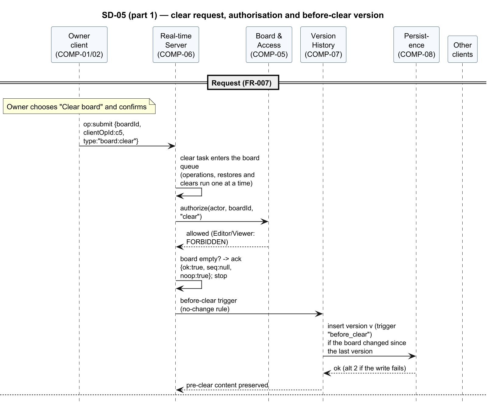
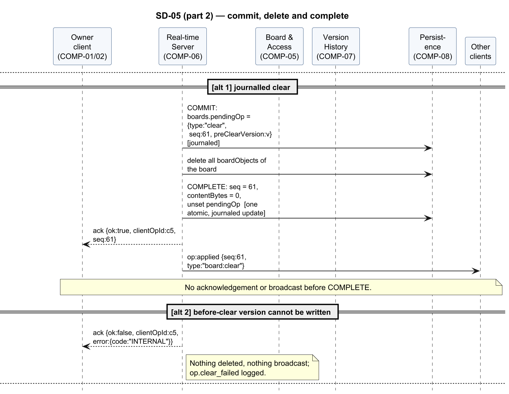
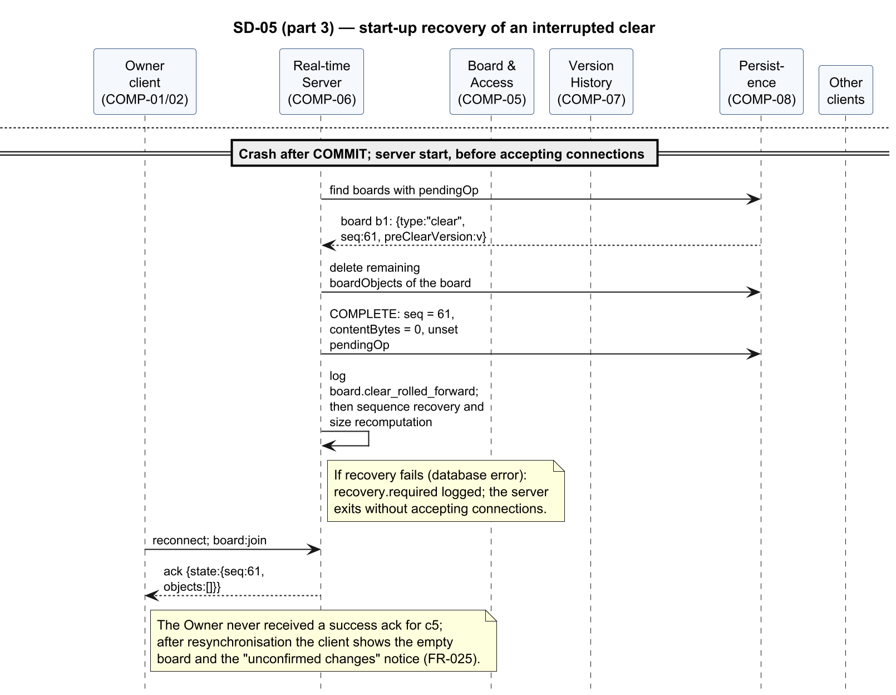

<!-- Owner: Rachit | Reviewers: Krishna, Prithvi | Status: v1.0 -->

#### SD-05 — Clear the board with interrupted-clear recovery

Realises FR-007, FR-030, FR-051. The Owner's `board:clear` runs as a task in the board queue: the
server applies the "before clear" version trigger, commits the clear in the durable journal
(`boards.pendingOp`), deletes the board objects and completes the journal entry with the new
sequence number in one atomic update; only then is the clear acknowledged and broadcast. If the
server stops after the commit, start-up recovery completes the clear before any client can
reconnect (§3.6).

Figures 29–31 show the flow in 3 parts.

