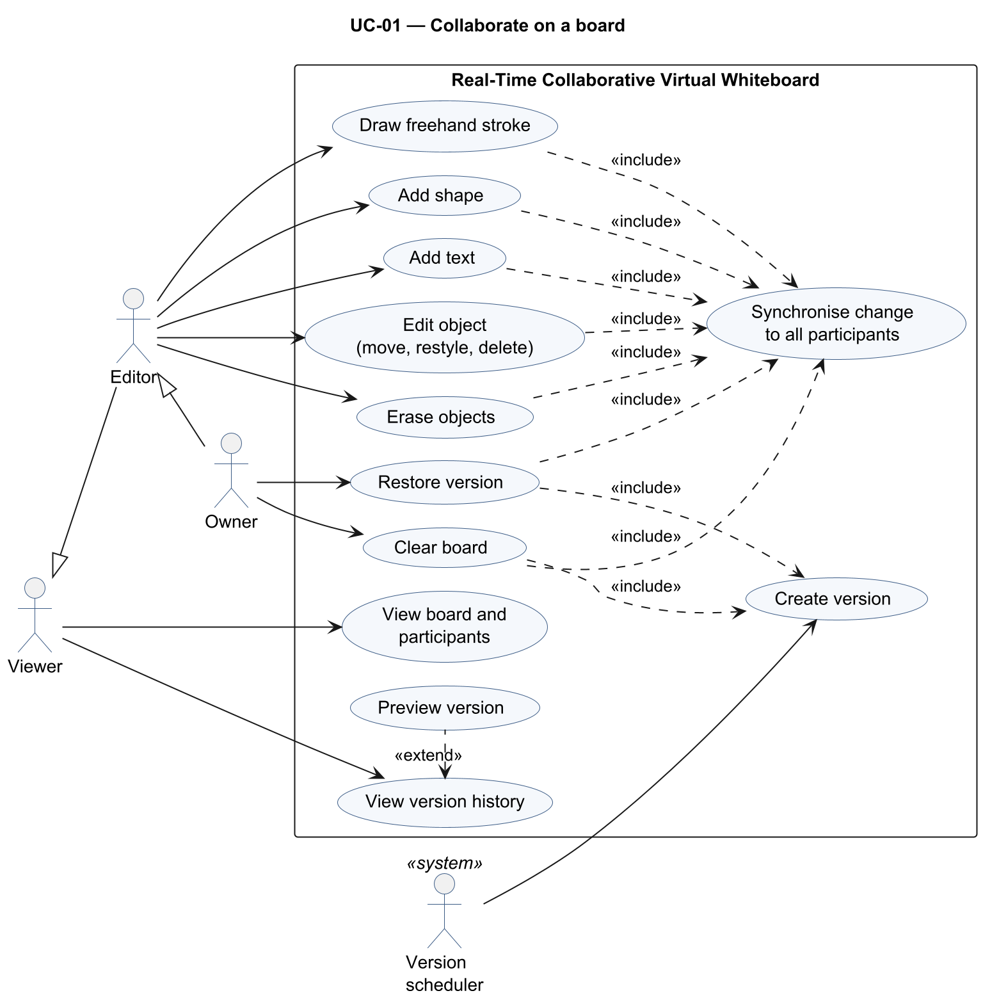
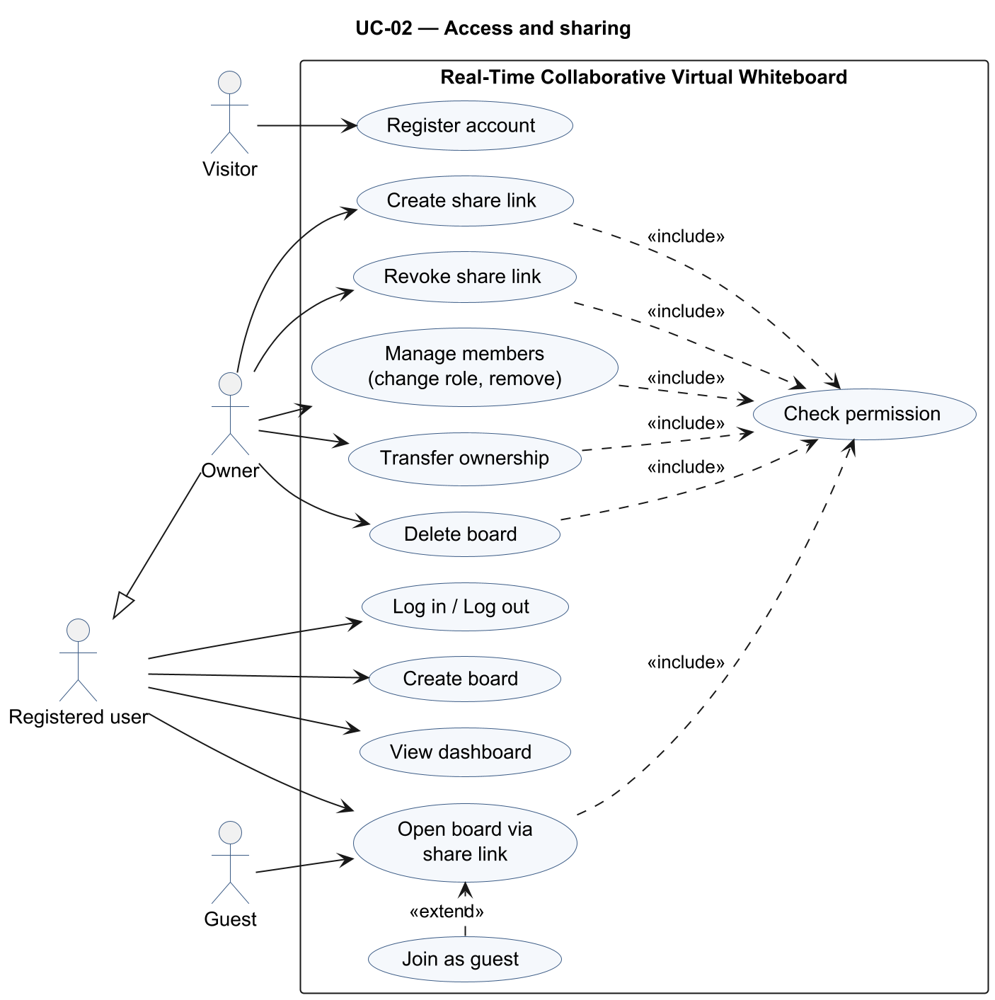

<!-- Owners: Rachit (7.1 UC-01), Prithvi (7.2 UC-02) | Reviewers: Krishna, Pranav | Status: v1.0 -->

## 7. System models and diagrams

The template requires at least two UML use-case diagrams. Diagram sources are in
`docs/diagrams/src/` (PlantUML) and rendered images in `docs/diagrams/png/`.

### 7.1 UML Use-Case diagram UC-01 — Collaborate on a board

<!-- Owner: Rachit -->

Figure 1 shows the use cases for working on a board.

Actors: **Viewer**, **Editor** (inherits Viewer), **Owner** (inherits Editor), and the
**Version scheduler** (a time-based system actor that triggers automatic versions).

| Use case | Primary actor | Requirements |
|---|---|---|
| View board and participants | Viewer | FR-024, FR-052 |
| View version history / Preview version | Viewer | FR-031, FR-032 |
| Draw freehand stroke | Editor | FR-001, FR-002, FR-008 |
| Add shape / Add text | Editor | FR-003, FR-004, FR-008 |
| Edit object (move, restyle, delete) | Editor | FR-005 |
| Erase objects | Editor | FR-006 |
| Clear board («include» Create version — creates a version only if the content changed, §4.3) | Owner | FR-007, FR-030 |
| Restore version («include» Create version — always creates a version) | Owner | FR-033, FR-034 |
| Create version automatically (every *T* minutes, subject to the no-change rule) | Version scheduler | FR-030 |
| Synchronise changes («include» from every editing use case) | — | FR-020 to FR-023 |

### 7.2 UML Use-Case diagram UC-02 — Access and sharing

<!-- Owner: Prithvi -->

Figure 2 shows the use cases for accounts, boards and sharing.

Actors: **Visitor**, **Registered user**, **Guest**, **Owner** (inherits Registered user).

| Use case | Primary actor | Requirements |
|---|---|---|
| Register account | Visitor | FR-040 |
| Log in / Log out | Registered user | FR-041 |
| Create board / View dashboard | Registered user | FR-042, FR-043 |
| Open board via share link | Registered user, Guest | FR-046 |
| Join as guest («extend» Open board via share link) | Guest | FR-046 |
| Create share link / Revoke share link | Owner | FR-045, FR-047 |
| Manage members (change role, remove) | Owner | FR-049 |
| Transfer ownership (to an Editor or Viewer member) | Owner | FR-050 |
| Delete board | Owner | FR-044 |
| Check permission («include» from every protected use case) | — | FR-051, SEC-REQ-003 |
